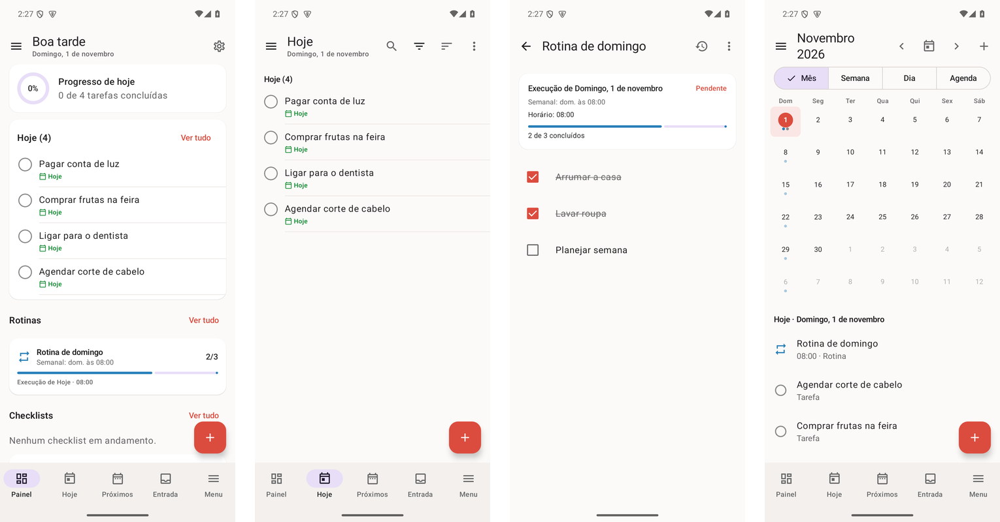

<div align="center">

# Organizador

**Tarefas, checklists, rotinas e notas — tudo no seu celular, sem internet, sem conta e sem anúncios.**

<a href="https://github.com/diegonogueira4567-star/organizador/releases/latest/download/Organizador.apk">
  
</a>

[](https://github.com/diegonogueira4567-star/organizador/releases/latest)
[](https://github.com/diegonogueira4567-star/organizador/releases)
[](LICENSE)



</div>

## Como instalar

1. **No celular**, toque em **[Baixar APK](https://github.com/diegonogueira4567-star/organizador/releases/latest/download/Organizador.apk)** (sempre a versão mais recente).
2. Abra o arquivo baixado. Na primeira vez, o Android pede para **permitir instalar apps desta fonte**
   (navegador ou gerenciador de arquivos): permita e volte.
3. Toque em **Instalar**. Pronto.

Requer Android 8.0 ou mais recente. Para atualizar, baixe a versão nova e instale por cima: seus dados são mantidos.
Histórico de versões em [Releases](https://github.com/diegonogueira4567-star/organizador/releases).

## O que ele faz

- **Tarefas** com prazo, prioridade, projetos, etiquetas, subtarefas, lembretes e repetição.
- **Checklists e rotinas** diárias, semanais, de sábado, dias escolhidos, mensais, anuais… cada dia começa do zero
  e o histórico de execuções fica guardado.
- **Notas** com títulos, negrito, listas, caixas de seleção, tabelas, imagens e salvamento automático.
- **Calendário** (mês, semana, dia, agenda), **painel** personalizável e **estatísticas**.
- **Backup** em arquivo com senha opcional e **bloqueio** por PIN ou digital.
- **Privacidade:** o app não tem permissão de internet. Nada sai do seu celular.

---

## Para desenvolvedores

Aplicativo nativo em Kotlin + Jetpack Compose (Material 3), Room/SQLite, Hilt, WorkManager.

| Item | Local |
|---|---|
| Código-fonte | `domain/`, `data/`, `app/`, `benchmark/` |
| Documentação técnica | `docs/` |
| Relatório de testes | `docs/TESTING.md` |
| Bugs corrigidos e limitações conhecidas | `docs/BUG_REPORT.md` |

### Requisitos de build

- JDK 17+ (testado com Temurin 21 em `~/Android/jdk-21`)
- Android SDK com plataforma 35 e build-tools 35 (`local.properties` → `sdk.dir`)
- Gradle 8.10.2 (wrapper incluído), AGP 8.7.3, Kotlin 2.0.21

### Compilar e executar

```bash
export JAVA_HOME=$HOME/Android/jdk-21
./gradlew :app:assembleDebug          # APK de debug (app/build/outputs/apk/debug)
./gradlew :app:installDebug           # instala no aparelho/emulador conectado
./gradlew :app:assembleRelease        # APK de release minificado e assinado
```

#### Assinatura de release

As credenciais **não ficam no repositório**. O build lê de `~/.gradle/gradle.properties` (ou variáveis de ambiente):

```
ORGANIZADOR_STORE_FILE=/caminho/organizador-release.jks
ORGANIZADOR_STORE_PASSWORD=...
ORGANIZADOR_KEY_ALIAS=organizador
ORGANIZADOR_KEY_PASSWORD=...
```

Nesta máquina o keystore foi criado em `~/.android-keystores/organizador-release.jks` (RSA 3072, validade 10.000 dias).
**Faça cópia de segurança desse arquivo e da senha**: sem eles não é possível publicar atualizações com a mesma assinatura.
Sem as propriedades, `assembleRelease` gera um APK não assinado.

### Testes

```bash
./gradlew :domain:test :data:testDebugUnitTest                         # JVM (rápidos)
./gradlew :data:connectedDebugAndroidTest :app:connectedDebugAndroidTest # aparelho/emulador
./gradlew :app:lintDebug
./gradlew :benchmark:connectedBenchmarkAndroidTest   # inicialização, fluidez e teste de processo morto
```

Resultados e cobertura por requisito em [`docs/TESTING.md`](docs/TESTING.md).

### Publicar uma nova versão

Aumente `versionCode`/`versionName` em `app/build.gradle.kts`, gere `./gradlew :app:assembleRelease` e crie a release
anexando o APK **também com o nome `Organizador.apk`** — é esse nome que mantém o botão "Baixar APK" apontando
sempre para a versão mais nova:

```bash
cp app/build/outputs/apk/release/app-release.apk /tmp/Organizador.apk
gh release create vX.Y.Z /tmp/Organizador.apk --title "Organizador X.Y.Z" --notes "Novidades…"
```

### Documentação

- [ARCHITECTURE.md](docs/ARCHITECTURE.md) — módulos, camadas, decisões
- [DATABASE.md](docs/DATABASE.md) — tabelas, relacionamentos, índices, migrações
- [RECURRENCE_SYSTEM.md](docs/RECURRENCE_SYSTEM.md) — regras, execuções, janelas, fuso/horário de verão
- [BACKUP_SYSTEM.md](docs/BACKUP_SYSTEM.md) — formato, integridade, criptografia, restauração
- [TESTING.md](docs/TESTING.md) — estratégia e relatório
- [CHANGELOG.md](docs/CHANGELOG.md)
- [BUG_REPORT.md](docs/BUG_REPORT.md)

## Licença

Código distribuído sob a [licença MIT](LICENSE): pode ser usado, copiado, modificado e redistribuído,
inclusive em outros projetos, desde que o aviso de copyright seja mantido. O software é fornecido sem garantia.
